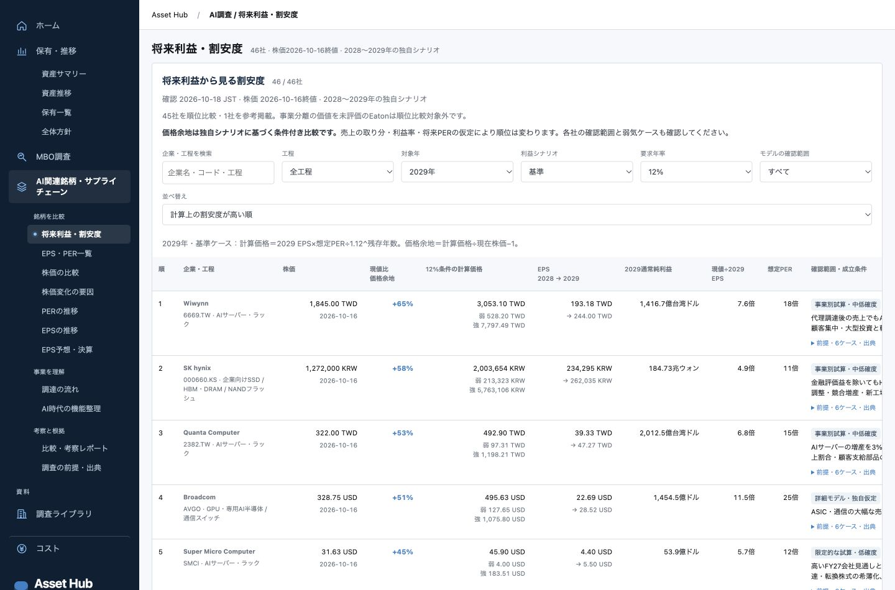

# AI関連46社 将来利益・割安度の本番反映｜2026-10-18

[非公開Asset Hubの「将来利益・割安度」](https://asset-hub-pvgbytjsqa-an.a.run.app/#ai/forward)へ反映した。元の8社の詳細モデルに38社の事業別試算を加え、上場46社・2028/2029年・弱気/基準/強気の276ケースを保存した。株価は2026-10-16終値。Eatonは事業分離価値を未評価のため参考行とし、比較可能な45社を並べる。

## 表の内容

株価、条件付きの計算価格と現値比、2年分のEPS、通常純利益、現値÷将来EPS、想定PER、モデル確認範囲、成立条件を掲載。検索・工程・年・ケース・要求年率・確認範囲・並べ替えを切り替えられる。各社の6ケース、計算前提、出典を開け、CSVで全ケースを取得できる。赤字ケースは利益法による評価不能として扱う。

計算上の価格余地は終点EPS×仮定PERを要求年率で割り引いた比較であり、予測リターンや購入優先順位ではない。途中の現金蓄積・還元・資本負担、シェアや採算、想定PERによって評価が変わる。

- [研究・再現方法](../../../research/themes/ai-valuation-ranking/2026-10-18/README.md)
- [比較レポート](../../../research/themes/ai-valuation-ranking/2026-10-18/report.md)
- [計算の検証記録](../../../research/themes/ai-valuation-ranking/2026-10-18/validation.json)
- [デプロイ計画・反映ファイルのハッシュ](deployment-plan.json)
- [本番検証結果](checks.json)

## 検証と反映

独立した調査・モデル監査とUIレビューを実施し、株数・転換条件・普通株/ADR・通貨・分割・一時利益を照合した。特にSMCIの最大転換希薄化、Lenovoの転換条件、Wiwynnの株式配当、Samsungの利益参加優先株を反映した。数式・入力・株価ハッシュの照合は通過したが、独自の将来シナリオが実現することを保証するものではない。

JavaScript全133テスト、デザイントークン、差分形式、カタログ、8アーカイブの保持チェックが通過。ブラウザでは1440px/375px、46行、順位、検索・工程・確認範囲、年・ケース・要求年率、赤字、詳細6ケース、既存EPS/PER画面との往復、コンソールエラーなしを確認した。本番で長い工程名が隣列に重なる箇所を修正し、折り返しを再確認した。

稼働イメージを土台に、今回のWeb5ファイルと関連する新規調査35ファイルだけを重ねた。カタログは対象4エントリだけを統合し、無関係なローカル変更を含めなかった。最初のビルドで既存の無関係な332ファイルを同一ハッシュで保持。続くCSS1ファイル修正でも、他372ファイルを同一ハッシュで保持した。

最終本番リビジョンは `asset-hub-00042-kb2`、トラフィック100%。IAP有効、閲覧者2名とCloud Runのinvokerポリシーは反映前後で同一。イメージだけを更新し、他サービス・費用ジョブは変更していない。

