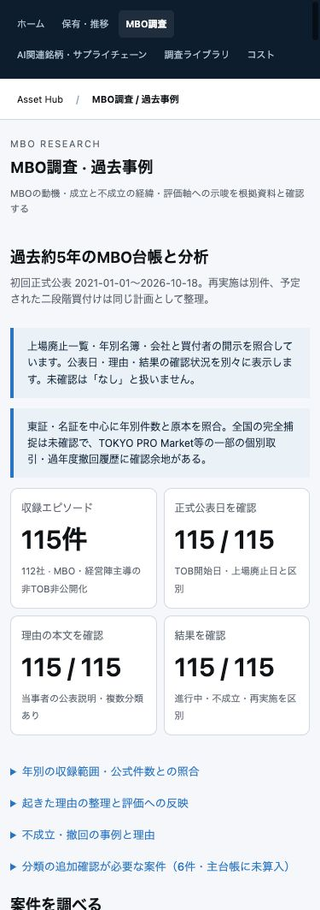

# MBO約5年台帳と評価項目の本番反映

2026-10-18。ユーザー依頼により[過去事例タブ](https://asset-hub-pvgbytjsqa-an.a.run.app/#mbo/cases)を115エピソード・112社・212原本URLへ拡張し、6件の分類未確定を別枠表示した。正式MBO113件、MBOに準ずる非TOB非公開化2件。不成立6件・再実施・別買収者・上廃実績と予定を区別する。

[調査レポート](../../../research/themes/mbo-evaluation/2026-10-18/census-2021-2026/report.md)・[Astraレビューの反映](../../../research/themes/mbo-evaluation/2026-10-18/census-2021-2026/adoption-notes.md)・[部署別の原本確認と限界](../../../research/themes/mbo-evaluation/2026-10-18/census-2021-2026/README.md)。

## 反映

稼働中の00048イメージを固定し、MBO画面・閲覧用DTOの5ファイル（新規JS2件を含む）だけを重ねた。ビルド内で既存ハッシュ、追加ファイル集合、他381ファイルの保持を検証。00049-mbrへ100%切替、IAP有効・閲覧許可2アカウントを確認した。無関係な作業中コード・調査ファイルはイメージへ混入させていない。commit・pushは行っていない。

閲覧用結果は非公開GCSの既存世代を条件に更新し、並行更新の上書きを防いだ。計算はMac内で実行。最新runは9d94b45f8ffc、旧2runも閲覧可能。新3項目を含む15項目は原本のない候補で未確認を維持し、価格・財務・DCF/LBO・イベント・手動作業判断・入力ID・旧runバイト列の保持を検証済み。

## 検証

Python72件＋localhost HTTP17件、JavaScript38件が成功。台帳の参照・重複・公表期間・非TOB区分・上廃のみ確認・動機集計の分母も検証した。旧8件JSONと旧9件表示データは変更なし。

本番Chromeで115件、INFORICH日本語検索と3つの日付、不成立6件の絞込、パイプドHDの初回不成立と再成立の2件、インヴァストの非TOB、最新runの未解決15件と追加項目の基準を確認。consoleの警告・エラー0。ブラウザの一時表示幅はresetし、全115件を表示したタブを残した。

全国の完全捕捉・予測精度の実証は宣言していない。TPM52行の個別一次確認と、2026別一覧106行の分類を行ったうえで、経営陣参加が確認し切れない6取引を主表に混ぜず残した。

[反映マニフェスト](deployment-plan.json)・[検証JSON](checks.json)

