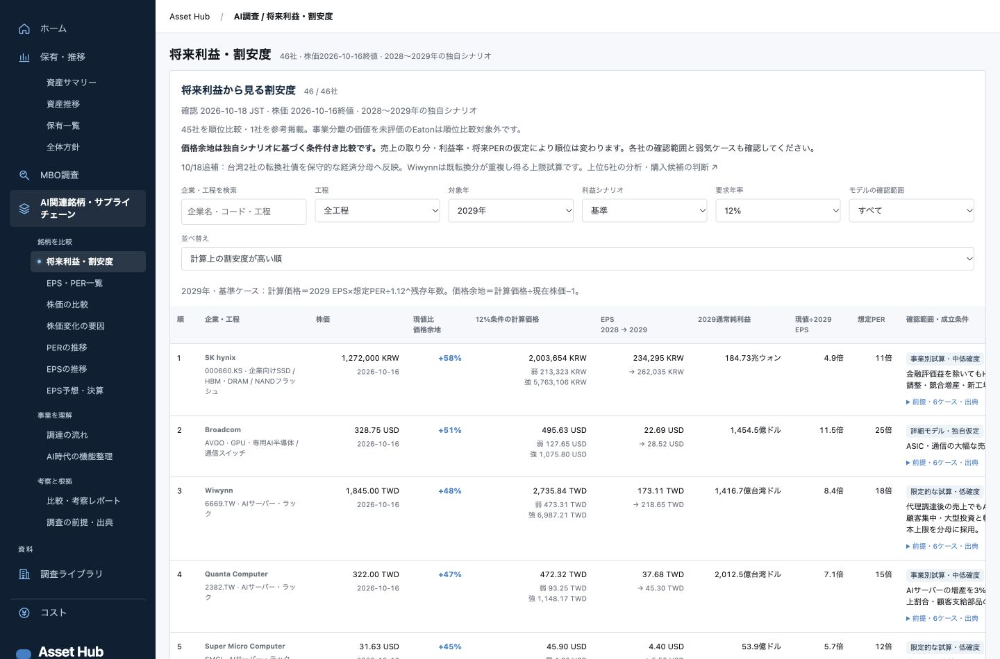

# 上位5社の深掘り・台湾CB訂正｜2026-10-18

[本番の将来利益・割安度](https://asset-hub-pvgbytjsqa-an.a.run.app/#ai/forward)に、[上位5社の詳しい分析](../../../research/themes/ai-valuation-ranking/2026-10-18/top-five-review.md)と訂正を反映した。買いたい順は独自判断でBroadcom、SK hynix、Quanta、Wiwynn、SMCI。計算上の割安順と区別する。

初回表の台湾2社には既存CB潜在株の織込み不足があり、売上・純利益・株価を変えず経済EPSの分母を補正した。現在発行株に原発行CB全元本の潜在株を加え、以前と同じ将来株数増を置く。最新残存元本は確定していないため既転換分の重複があり得る上限試算で、正確なGAAP分母ではない。Wiwynn2029基準EPS244.00→218.65、Quanta47.27→45.30。初回公開版をrevisions/initial-publishedに残した。

独立レビューで12ケースの全計算と、利益・株価据置、上限分母の注記を照合。上位5社の資金回収・利益率・倍率複合感応度も計算した。全46社276ケースの整合を含む5テスト、デザイントークン、差分形式、カタログ・8アーカイブが通過。ブラウザで375px/1440px、46行、訂正注記、旧新EPSと順位、詳細レポートの本文、コンソールエラーなしを確認した。

- [計算と旧新比較](../../../research/themes/ai-valuation-ranking/2026-10-18/top-five-calculations.json)
- [反映計画とハッシュ](deployment-plan.json)
- [本番チェック](checks.json)

本番44を土台に16ファイルだけを追加・更新し、他363ファイルとカタログを同一ハッシュで保持した。最終45-l4zへ100%反映。IAP有効、閲覧者2名とinvokerポリシーは変更なし。費用ジョブ・他サービス・Gitへのcommit/pushは行っていない。

