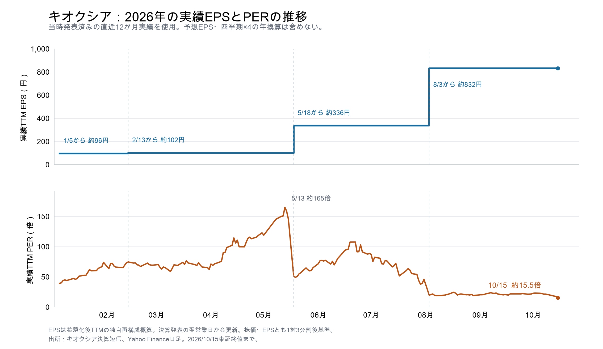

# 予想PER3倍台は本当に買いか――キオクシアの低PERを再検証

調査：2026年10月15日夜（JST）。ユーザーの「PERがかなり小さく、買いに見える。そこを十分リサーチしてほしい」という依頼への追加調査。国内株は同日終値12,880円、比較用の買値は12,000円。価格・EPSは分割後・円建て。計算は[per-audit.mjs](per-audit.mjs)、保存値は[per-audit.json](per-audit.json)。

**22時台の追加監査：** [第7節](#7-per差分の追加監査22時台再確認)に、四半期別の一次資料と、予想更新後の差分を追記した。前半のEPS3,443円・PER3.74倍は19:20表示と10/14集計を照合した時点の値。22時台にはIFISの純利益集計が約1.62%低く更新され、EPS画面とは時点差がある。古い値を黙って上書きせず区別する。

## 結論

【独自判断】**12,000円台には、現物で分割購入を検討するだけの投資妙味がある。低PERは桁・分割・通貨の誤りではなく、実績利益と現金回収にも裏付けがある。** 「好況時は低PERになる」という一般論だけで見送るのは、現在の強い収益と企業SSDの構造変化を十分評価していない。

一方、**キオクシアだけが異常に低PERという状況でもない。** SK hynixなども低倍率で、メモリ業界全体について高利益の持続性が評価上の争点になっている。高い利益率が販売価格に強く依存し、顧客との契約による価格下限も未確認なので、PER3倍台を無条件の割安とは扱わない。

今回の調査で、12,000円台を買い候補とする判断は維持する。12,000円という一点を必ず待つ根拠の精度は低く、**12,500〜13,000円で少量から始めるという判断にも合理性がある。** ただし、決算確認後に追加できる余力を残す。取引を実行したものではない。

## 1. まずPER3.4倍の基準を再点検した

【外部予想】10月15日更新の銘柄スカウターライト（IFIS提供）は、2027年3月期予想EPSを**3,443.0円**、2028年3月期を**4,834.4円**と表示している。「1年後コンセンサス」4,197.8円は別項目で、今期・来期とは区別する。[IFIS／マネックス原表示](https://scouter.monex.co.jp/report/theoryDps/285A)

会社は2027年3月期の通期利益予想を公表していない。ここで約3.5倍とするPERは外部コンセンサスに基づく予想PERである。

| EPSの基準 | EPS | 12,000円のPER | 10/15終値12,880円のPER |
|---|---:|---:|---:|
| 直近12か月・希薄化後実績の概算 | 約833.50円 | 約14.40倍 | 約15.45倍 |
| 今期2027/3・IFIS表示予想 | 3,443.0円 | **約3.49倍** | **約3.74倍** |
| 来期2028/3・IFIS表示予想 | 4,834.4円 | **約2.48倍** | **約2.66倍** |

直近12か月EPSは、公式2026/3期希薄化EPS1,009.15円＋2026年4〜6月1,525.09円−前年同期33.75円＝2,500.49円（分割前）を3で割った構成値。期中の株数変動があるため、過去12か月純利益を最新株数で割った値とは一致しない。[Q1決算短信](https://ssl4.eir-parts.net/doc/285A/tdnet/2859905/00.pdf)、[前年度決算短信](https://ssl4.eir-parts.net/doc/285A/tdnet/2815628/00.pdf)

**先ほどの「3.4倍」は、独自EPS3,536円による約3.39倍を丸めたものだった。** 独自EPSは、IFIS今期純利益予想5.648790兆円を、8月31日の自己株控除後株数の分割後換算15億9,751万5,021株で割っている。外部表示EPSより約2.7%大きい。年度EPSの分母は期中平均株数が原則で、買戻し後株数を全年度へ当てる独自近似をIFIS表示そのものと同一視しない。外部表示に統一すれば12,000円で約3.5倍であり、低倍率という結論は変わらない。[今期純利益集計](https://kabuyoho.jp/sp/reportAnalyst?bcode=285A)、[8月末株数のEDINET報告p.3](https://disclosure2dl.edinet-fsa.go.jp/searchdocument/pdf/S100Z1UD.pdf)

会計基準も点検した。Q1のIFRS親会社帰属純利益は8,421.65億円、Non-GAAPは8,869.52億円。Q2単独予想もIFRS1兆2,700億円、Non-GAAP1兆2,800億円で、会社実績・会社予想との照合にはIFRS利益を使っている。IFISは当期利益として集計しているが、個別アナリストの会計調整内容までは未確認。分割前Q1希薄化EPS1,525.09円は分割後508.36円。分割で利益倍率を誤って3分の1にしたものではない。

### 「以前は30倍ではなかったか」の再確認

【2026年10月15日夜・追加照合】今の株価12,880円を固定しても、どの期間の利益を使うかでPERは大きく変わる。

| 利益の基準 | EPS | 12,880円のPER |
|---|---:|---:|
| 前期2026/3・IFIS表示実績 | 338.0円 | 約38.1倍 |
| 直近12か月・S&P Global系表示実績 | 832.23円 | 約15.48倍 |
| 今期2027/3・IFIS市場予想 | 3,443.0円 | 約3.74倍 |

前期と今期の表示EPSは約10.19倍違う。したがって「過去に30倍程度に見えた」ことと「今期予想では3倍台」は両立し、株価下落だけで倍率が10分の1になったわけではない。直近12か月のS&P Global系表示も、上の会社短信から構成した約833.50円・約15.45倍とほぼ整合する。端数差は各期間の株数等の扱いが異なるため、同一計算とは扱わない。[IFIS／マネックス](https://scouter.monex.co.jp/report/theoryDps/285A)、[StockAnalysis／S&P Global](https://stockanalysis.com/quote/tyo/285A/statistics/)

「30倍」の元の画面は特定できていない。会話冒頭の信用倍率の話を指しているなら、10月9日現在の信用倍率は29.80倍であり、利益を分母にするPERとは別指標。同じマネックス画面には「予想PER1年平均32.3倍」もあるが、これも現在の今期予想PERそのものではない。[信用倍率の表示](https://finance.yahoo.co.jp/quote/285A.T)

外部予想も別の集計で照合した。StockAnalysis掲載のS&P Global系2027/3期純利益予想は約5.62兆円（予想表更新9月29日）で、IFISの5.648790兆円と近い。低い倍率がIFISだけの桁誤りによるという証拠はない。ただし同サイトのForward PE 2.96倍は対象期間・調整方法を十分確認できず、今期IFISの3.74倍へ混ぜない。[別集計の予想表](https://stockanalysis.com/quote/tyo/285A/forecast/)

なお、IFISの脚注は「EPSは最終更新日付時点の株数にて計算」と明示する。上記の独自EPSとの約2.7%差を、加重平均株数の違いだけに起因すると断定しない。外部表示EPS3,443円を比較の基準に統一する。

【独自感応度・株価固定】今期予想EPSが半分ならPER約7.48倍、4分の1なら約14.96倍、10分の1なら約37.41倍。これは減益予想ではなく、どの利益水準まで割安性が残るかを見る条件計算である。利益を変更せずPER30倍を当てた株価103,290円を、そのまま妥当株価や上昇余地とは扱わない。

### EPSが前期の約10倍になる理由

【会社実績】最大の要因はNANDの販売単価上昇。Q1説明p.9ではドル建ての平均ASPと同条件比較のASPがともに前四半期比約70%上昇し、ビット出荷は一桁台前半増。製品構成や出荷数量の増加だけでは説明できない値上がりが起きた。会社は生成AI向けデータセンター需要を主因に挙げている。[会社説明資料](https://ssl4.eir-parts.net/doc/285A/ir_material_for_fiscal_ym4/209425/00.pdf)

前四半期からQ1へ、売上は約1.003兆円から1.767兆円へ約76%増えた一方、売上原価は約0.360兆円から0.387兆円へ約8%増。IFRS営業利益は約0.597兆円から1.270兆円へ約113%増えた。製造費用が販売単価と同じ割合で増えないため、値上げ分が大きく利益に残る。原価が下がったと説明するのは誤り。

【独自分解・外部予想】IFIS通期集計は、前期から今期へ売上2.337628→10.209959兆円（約4.37倍）、純利益0.554490→5.648790兆円（約10.19倍）。純利益率は約23.7%→55.3%（約2.33倍）となる。売上約4.37倍×純利益率約2.33倍で、純利益約10.19倍を説明できる。EPS増加の中心はこの純利益増加。[IFIS集計](https://kabuyoho.jp/sp/reportAnalyst?bcode=285A)

【会社実績】前期通期の純利益5,544.90億円の約74%は、最後の2026年1〜3月の約4,077億円だった。前期EPSには値上がり前の低利益期間も含まれるため、今期との年間比較が大きくなる。今の四半期からさらに利益が10倍になるという予想ではない。4〜6月だけで純利益8,421.65億円となり、すでに前期通期を上回っている。[Q1会社短信・JPX原表示](https://www2.jpx.co.jp/disc/285A0/081220260731505265_tse-qcedifsm-285A0-202607313285A0-ixbrl.htm)

【予想の要求水準】ただし今期EPS3,443円は、足元利益の単純な年換算ではない。Q1実績0.842165兆円＋Q2単独会社予想1.270兆円＝上期2.112165兆円に対し、IFIS通期5.648790兆円を達成するには下期3.536625兆円、四半期平均1.768313兆円が必要。これはQ2会社予想より約39%高い。実際に起きた大幅増益と、今後さらに増益するという外部予想を分ける。

【会計上の確認】Nanya等の株式評価による資産増加約3,000億円はOCIで、会社説明p.13は損益への影響なしとする。これを巨額の一時利益でEPSが膨らんだ原因にはしない。円安と株数の変化も主因ではない。

## 2. 買いを支持する事実

### 通期コンセンサスだけで安く見えているわけではない

【会社実績】4〜6月期IFRS純利益は0.842165兆円。【会社予想】7〜9月期単独は1.270兆円。各四半期を単純に4倍し、8月末自己株控除後株数で比較すると、12,000円でのPERはそれぞれ**約5.69倍、約3.77倍**になる。四半期の年換算は正式な通期予想ではないが、直近の会社予想からも低い倍率が出る。[7月31日会社決算短信](https://ssl4.eir-parts.net/doc/285A/tdnet/2859905/00.pdf)

【外部予想】IFISの来期EPSは今期より約40.4%増える予想。少なくとも外部コンセンサス自体は「今期だけ利益が膨らみ、来期に急減する」という形ではない。ただし、予想の実現性は株価と別に検討する必要がある。[IFIS表示](https://scouter.monex.co.jp/report/theoryDps/285A)

### 利益は実際の現金回収を伴っている

【会社実績・独自再計算】Q1キャッシュフローを原表から再集計した。

| Q1項目 | 金額 |
|---|---:|
| 営業CF | ＋8,663.37億円 |
| 有形・無形資産取得 | −524.02億円 |
| 設備売却収入 | ＋12.17億円 |
| 政府補助金収入 | ＋120.26億円 |
| リース元本返済 | −79.29億円 |
| 投資・リース後CF（借入元本返済・自己株取得前） | **＋8,192.49億円** |

これは純利益の約97%。会社のCore FCF約8,272億円からリース元本返済を引いた計算に相当する。期間中のCFであり、期末の手元現金残高や全額還元可能額ではない。Nanya株取得782.20億円はこのCore FCFから除かれており、それも含む営業CF＋投資CF−リース返済では約7,410.90億円。それでも大きなプラスである。[決算短信CF表p.13](https://ssl4.eir-parts.net/doc/285A/tdnet/2859905/00.pdf)、[会社説明p.12](https://ssl4.eir-parts.net/doc/285A/ir_material_for_fiscal_ym4/209425/00.pdf)

ただしQ1の税支払は1,005.33億円に対し損益上の税費用は3,925.49億円。売掛金等増加のCF押下げ4,720.52億円もある。設備投資の時期も偏るため、8,192億円×4＝約3.28兆円を将来CF予想として採用しない。現金を稼いでいる証拠として使い、将来の利益・現金の下限保証には使わない。

【会社方針】7月31日Q&Aでは、必要な設備・研究開発・人材・運転資金を確保した後、余剰CFの約半分を株主還元に充てる方針を説明している。仮に将来の余剰CFが5兆円なら還元2.5兆円は12,000円時の時価総額約19.17兆円に対して約13%に相当するが、**これは独自の条件計算で、決定済み配当や還元利回りではない。**[会社Q&A](https://ssl4.eir-parts.net/doc/285A/ir_material_for_fiscal_ym4/209428/00.pdf)

### 需給・製品・顧客の強さも確認できる

【会社見通し】6月2日Investor Day Q&Aでは、2027年後半も需給がタイトで急激な価格下落を見込まないと説明。CMシリーズの主要企業・ハイパースケーラー顧客への採用・認定も説明している。[公式Q&A](https://www.kioxia-holdings.com/content/dam/kioxia-hd/shared/ir/library/event/asset/Investor-Day-2026-JA-QA.pdf)

【外部予想】TrendForceの10月7日原調査公開要旨も、企業SSDの需要、供給規律、増産の時間差を背景に今後2年のタイトな需給を説明している。10月14日には主要CSP9社の2027年設備投資予想を前年比60%増へ引き上げた。単なる市場の期待だけでなく、企業・調査会社の需要見通しにも買いの根拠はある。いずれも将来予想で、前払い契約の全条件や有料調査本文は未確認。[10月7日要旨](https://www.trendforce.com/research/download/RP261007NY)、[10月14日原調査](https://www.trendforce.com/presscenter/news/20261014-13269.html)

## 3. それでも低PERだけで買い切れない理由

### 利益が販売価格の高さに強く依存する

【会社実績・独自計算】Q1のドル建て平均販売価格は前四半期比約70%上昇、ビット出荷は一桁台前半増。Q2予想は売上2.39兆円に営業利益1.89兆円で、IFRS営業利益率は約79.1%。数量急増より販売価格上昇が利益を押し上げている。[会社説明p.9・15](https://ssl4.eir-parts.net/doc/285A/ir_material_for_fiscal_ym4/209425/00.pdf)

【独自計算】IFIS通期予想からQ1実績とQ2会社予想を引くと、下期は営業利益率**約81.2%**、純利益率**約58.4%**を要求する。会社Q2予想でも高収益の方向は裏付けられるが、通期予想は下期にさらに利益率が上がる前提である。

【独自ストレス】Q2会社予想を起点に、数量・為替・構成・総費用・税率を固定して販売価格だけ下げる機械的な計算では、次のようになる。

| Q2予想比の全社平均販売価格 | 年換算純利益 | 12,000円のPER |
|---|---:|---:|
| 変化なし | 約5.08兆円 | 約3.77倍 |
| −30% | 約3.13兆円 | 約6.12倍 |
| −40% | 約2.48兆円 | 約7.72倍 |
| −50% | 約1.83兆円 | 約10.45倍 |
| −60% | 約1.18兆円 | 約16.19倍 |

これは価格下落予想でも損失上限でもない。実際には数量、原価、先端品比率、在庫評価損、為替なども変わる。高い足元利益率は相応の値下がり耐性を持つ一方、価格下落が大きくなれば低PERは消える。

### LTAは進展しているが、利益の固定は確認できない

【会社公表】7月31日Q&Aは「CY2028出荷物量の50%をLTAでカバーする目標へ順調」と説明する。50%締結完了、固定価格・価格下限、最低購入義務、解約違約金、エンド顧客の前受金額は確認できない。非開示だから条件が存在しないとも断定しない。[公式Q&A](https://ssl4.eir-parts.net/doc/285A/ir_material_for_fiscal_ym4/209428/00.pdf)

有報の残存履行義務1,827.79億円は四日市JVの契約延長に関する製造サービス・継続供給で、2034年まで収益認識するもの。これをAI顧客LTAの確定受注として扱わない。ネット上の「巨額の顧客担保が利益を保証する」という引用も原本を確認できず、評価に使わない。[有報p.144](https://disclosure2dl.edinet-fsa.go.jp/searchdocument/pdf/S100YJ18.pdf)

### 全社がAI専用事業というわけではない

Q1のSSD & Storageは売上の約66%、その中でデータセンター・企業向けが60%超。全社のデータセンター・企業向けは概ね40%超となり、AI専用売上比率ではない。スマートデバイス等も残る。企業SSDの強さを全社の価格下限と読み替えない。[会社説明p.10](https://ssl4.eir-parts.net/doc/285A/ir_material_for_fiscal_ym4/209425/00.pdf)

中国YMTCは公式に122.88TBのQLC企業SSDを掲載しており、企業SSD市場へ入れない会社ではない。一方、海外大手CSPの認定・量産出荷量は未確認。近い将来の確定減益ではなく、2027〜28年の競争リスクとして扱う。[YMTC公式製品](https://www.ymtc.com/en/products/57.html?cat=36)、[Counterpoint・10月13日](https://counterpointresearch.com/en/insights/ymtc-files-for-landmark-ipo-after-climbing-to-no-3-in-global-nand-race-with-dram-next)

## 4. 同業も低PERなのか

すべて外部予想を株価÷EPSで再計算。**日本・韓国は10/15、米国は10/14の株価で日付が違う。予想期末・IFRSと調整後EPS・事業構成も異なるため、厳密な同条件比較ではない。**

| 会社 | 株価・現地時点 | 予想EPS・対象期 | PER | 比較上の違い |
|---|---|---|---:|---|
| キオクシア | 12,880円、10/15終値 | 3,443円、2027/3期 | **3.74倍** | IFIS当期利益集計。個別の調整内容は未確認 |
| Micron | 914.13ドル、10/14終値 | 176.15ドル、FY2027（2027/9/2終了） | **5.19倍** | 調整後。DRAM・HBMの比重大 |
| Sandisk | 1,403.34ドル、10/14 15:59の終盤値 | 214.82ドル、FY2027（2027/7/2終了） | **6.53倍** | 調整後。NANDの比較対象に近い |
| SK hynix | 1,262,000ウォン、10/15終値 | 355,218.90ウォン、2026/12期 | **3.55倍** | 調整後。DRAM・HBMの比重大 |
| Samsung | 210,000ウォン、10/15終値 | 47,826.95ウォン、2026/12期 | **4.39倍** | 調整後。スマホ等の事業も含む |

出典：[Micron予想](https://finance.yahoo.com/quote/MU/analysis/)、[Sandisk予想](https://twelvedata.com/markets/542904/stock/nasdaq/sndk/analysis)、[SK hynix予想](https://stockanalysis.com/quote/krx/000660/forecast/)、[Samsung予想](https://stockanalysis.com/quote/krx/005930/forecast/)。米国2社の調整後判定は予想表の前年EPSを会社公表Non-GAAP実績に照合。韓国2社は提供元S&P Globalの調整後EPSという表示を確認した。[Sandisk実績の一次資料](https://investor.sandisk.com/news-releases/news-release-details/sandisk-reports-fiscal-fourth-quarter-2026-financial-results)

期末は[Micron公式資料](https://investors.micron.com/static-files/0504f483-84b1-4e01-a30e-67b6b6ea1422)、[Sandisk公式資料](https://www.sec.gov/Archives/edgar/data/2023554/000130817926000423/sndk-20261005.htm)で照合。データサイトの8月・6月という近似ラベルを、正確な会計年度終了日と混同しない。

【独自考察】キオクシアにSandiskより低い倍率が付いていることは買いの材料。ただしSK hynixと比べると同程度で、メモリ株全体への低倍率評価という側面が大きい。NANDとHBMの違いを無視して同じPERへの収れんを期待しない。

【歴史的実績】Micronは2018年9月21日株価44.74ドル、FY2018 GAAP EPS11.51ドルで実績PER約3.89倍だったが、翌FY2019 EPSは5.51ドルへ約52%減った。これは実績PERの例で、現在の予想PERとの直接比較ではない。過去の低倍率だけを根拠に現在も同じ下落が起きると予想するものでもない。[2018 EPS公式](https://investors.micron.com/news/press-release/2018/Micron-Technology-Inc--Reports-Results-for-the-Fourth-Quarter-and-Full-Year-of-Fiscal-2018-09-20-2018/default.aspx)、[当日の株価報道](https://finance.yahoo.com/news/stocks-trade-record-high-sp-rolls-new-communications-sector-135004782.html)、[2019 EPS公式](https://investors.micron.com/news/press-release/2019/Micron-Technology-Inc--Reports-Results-for-the-Fourth-Quarter-and-Full-Year-of-Fiscal-2019-09-26-2019/default.aspx)

## 5. どれほどの利益低下を想定すれば、割安さが消えるか

【独自計算】12,000円の自己株控除後時価総額は約19.17兆円。正常化後にPER何倍が妥当かを独自に置くと、価格を説明する年間純利益は次の水準になる。

| 仮に付ける正常化後PER | 12,000円を説明する年間純利益 | 今期IFIS予想からの低下率 |
|---|---:|---:|
| 8倍 | 約2.40兆円 | 約58%減 |
| 10倍 | 約1.92兆円 | 約66%減 |
| 12倍 | 約1.60兆円 | 約72%減 |

**今期予想から大きく利益が落ちても、一定の倍率なら12,000円を説明できる。これが買いを検討する重要な根拠。** ただし8〜12倍も私の評価仮定で、利益下落時に市場がその倍率を付ける保証はない。業績が悪化し利益1兆円以下が続くケースでは、安全とはいえない。自己株控除後株数による時価総額ベースの試算で、IFIS表示EPSの分母とは異なる。

また、従来モデルと同じ最初の3年CFを5・4・3兆円、要求収益率13%、永久成長0%と置くと、12,000円を説明する4年目以降のCFは年約1.79兆円、12,880円なら約2.05兆円。前半3年間の高CFが実現するなら、以後の減速を一定程度吸収できる。これも市場の真の予想や下落確率を特定したものではない。

## 6. 今回の買い判断と、前の12,000円との関係

**買い候補としての判断は維持し、低PERの魅力には具体的な裏付けがあると評価する。** 今の利益が単なる会計上の調整だけで作られているという根拠はなく、会社予想、現金回収、企業SSDの需要見通しは買いを支持する。

一方、前の「CF5→4→3兆円、長期3兆円」というモデルは、現在の増益コンセンサスから機械的に導かれた予想ではない。**高収益が早めに正常化する購入判断用の独自ケース**である。年13%と25%の安全余裕にも一点の客観的な正解はなく、12,000円まで必ず待つべきだという精度はない。

長期CF3兆円は、例として純利益3.2兆円＋減価償却0.30兆円−設備投資0.47兆円−リース元本0.03兆円、運転資金増ゼロ・借入の純増減ゼロなら成立する。ただしこれは独自の橋渡し例であり、過去平均より高い利益水準が定着する前提である。長期CF1〜1.5兆円へ戻る弱気ケースも残す。

私なら、12,500〜13,000円で少量、12,000円前後を中心とする分割購入の判断を維持する。10月30日には、Q2実績だけでなく、10〜12月期会社予想、企業SSDの数量と価格、在庫・売掛金・税支払を含む営業CF、還元方針を確認する。事業が崩れて下がる場合は価格だけで追加しない。

**今回の調査で確認できないのは、将来利益の最低保証、注文取消の実数量、中国勢の海外大手顧客への供給規模、急落の終了時期。** 強気予想の実現性に賭ける部分は残るため、一括購入と同義の「無条件で買い」とはしない。

## 7. PER差分の追加監査（22時台再確認）

### 差を実績改善と将来予想に分ける

【独自再計算】株価は10/15東証終値12,880円に固定。前期2026/3の会社発表基本EPS1,024.07円を分割後に直すと341.36円で、実績PERは37.73倍。先の38.1倍は外部表示EPS338円に基づく値で、約1%の差がある。会社公表の基本EPSへそろえると次のようになる。

| 比較対象 | 利益・EPSの性質 | 年間相当の純利益 | EPS | 12,880円のPER |
|---|---|---:|---:|---:|
| 前期2026/3 | 通期実績・会社基本EPS | 0.554490兆円 | 341.36円 | 37.73倍 |
| 2026年4〜6月×4 | 直近四半期実績の単純年換算 | 3.368660兆円 | 2,053.21円 | 6.27倍 |
| 今期2027/3・IFIS旧表示 | 外部予想・10/14集計対応 | 5.648790兆円 | 3,443.00円 | 3.74倍 |
| 今期2027/3・IFIS更新値 | 外部純利益予想・10/15集計 | 5.557290兆円 | 約3,387.23円※ | 約3.80倍※ |

※更新EPSは、旧EPSに純利益更新率だけを適用した独自近似。IFISの新たな公表EPSではない。分母の変更がないと仮定する。四半期年換算も正式な通期会社予想ではなく、四半期と年間では期中平均株数が異なる。[前期会社短信](https://ssl4.eir-parts.net/doc/285A/tdnet/2815628/00.pdf)、[今期Q1会社短信・JPX](https://www2.jpx.co.jp/disc/285A0/081220260731505265_tse-qcedifsm-285A0-202607313285A0-ixbrl.htm)、[IFIS最新集計](https://kabuyoho.jp/sp/reportAnalyst?bcode=285A)、[旧EPS表示](https://scouter.monex.co.jp/report/theoryDps/285A)

純利益でそろえると、前期の四半期平均1,386.23億円に対し直近四半期は8,421.65億円で**約6.08倍**。最新の通期市場予想5.557290兆円は、その直近四半期×4の**約1.65倍**。約6.08×約1.65＝約10.02倍となる。したがって、約38倍から6.3倍への差は主に実績改善、6.3倍から3.7〜3.8倍への差はさらに増益する外部予想が生む。株数の小差を無視しても、この構図は変わらない。

### 前期全体と直近四半期の収益水準は大きく違う

【会社実績】単位は億円。Q2〜Q4単独は累計短信の差分から算出し、IFRS親会社帰属純利益に統一した。

| 四半期 | 売上 | 営業利益 | 親会社純利益 |
|---|---:|---:|---:|
| 2025年4〜6月 | 3,427.99 | 448.99 | 182.84 |
| 2025年7〜9月 | 4,483.46 | 859.21 | 406.62 |
| 2025年10〜12月 | 5,436.31 | 1,427.54 | 878.10 |
| 2026年1〜3月 | 10,028.52 | 5,967.95 | 4,077.34 |
| 前期2026/3合計 | 23,376.28 | 8,703.69 | 5,544.90 |
| 2026年4〜6月 | 17,671.17 | 12,700.17 | 8,421.65 |
| 2026年7〜9月・会社予想 | 23,900.00 | 18,900.00 | 12,700.00 |

前期の純利益の73.53%は最後の1〜3月に集中した。前期通期平均は値上げ前の低利益期間を含むため、今の利益水準より小さい。[前期Q2短信](https://ssl4.eir-parts.net/doc/285A/tdnet/2717197/00.pdf)、[前期Q3短信](https://www2.jpx.co.jp/disc/285A0/140120260212556330.pdf)、[前期通期短信](https://ssl4.eir-parts.net/doc/285A/tdnet/2815628/00.pdf)

低利益だった直接の理由も会社が説明している。前期Q3短信の本文p.4は、2025年1〜3月のPC・スマホ顧客の在庫調整で販売単価が大幅に下がり、その影響で2025年度前半も単価が弱含んだとする。AI・データセンター向けの出荷容量は増えても、累計平均単価が前年以下で、2025年4〜12月の営業利益は前年同期比34%減だった。[当該会社説明](https://www2.jpx.co.jp/disc/285A0/140120260212556330.pdf)

### 値上がりが利益を大きく増幅したことを原価から確認

【会社実績】2026年1〜3月から4〜6月へ、売上は約76%増、IFRS売上原価は3599億円から3871億円へ約7.6%増、減価償却等は764億円から761億円へほぼ横ばいだった。営業利益は約113%増。売上増7,642.65億円のうち営業利益増は6,732.22億円で、営業利益の増分は売上増の約88%。これは純粋な価格寄与率ではなく、数量・為替・構成・費用の変化も含む差分である。

Q1説明p.9では、ドル建て平均ASPだけでなく同条件ASPも前四半期比約70%増。ビット出荷は一桁台前半増、平均為替は155→160円/ドル。数量、ミックス、円安だけで大幅増益を説明するものではない。BiCS8比率上昇はコスト競争力に寄与するが、利益増への金額寄与は未開示。[会社Q1説明資料p.9・23](https://ssl4.eir-parts.net/doc/285A/ir_material_for_fiscal_ym4/209425/00.pdf)

【外部調査】TrendForceの8/18四半期集計は、4〜6月の企業SSD需要によるNAND供給不足が契約ASP引上げを可能にし、上位5社の合計売上が前四半期比77%増とする。同調査はDRAM・HBMを優先する設備投資がNAND新規供給を制限する点も挙げる。これは業界全体の説明で、キオクシアがHBMを製造しているという意味ではない。値上がりはキオクシア固有のEPS計算現象ではない。[TrendForce原調査](https://www.trendforce.com/presscenter/news/20260818-13186.html)

### 会計・株数で生じた差ではないか

- 1対3分割は株価とEPSを両方3分の1にするため、PERそのものを変えない。今回の比較は分割後に統一した。
- Q1 IFRS純利益8,421.65億円に対しNon-GAAPは8,869.52億円で、IFRSの方が低い。訴訟引当366億円、株式報酬194億円、ローン完済関連の一時金融費用約100億円などは押下げ要因。
- Nanya等の保有株式評価で資産が増えた約3,000億円はOCIで、会社p.13は損益に影響なしとする。これをEPS急増の原因と数えない。
- 8月の自己株買い16,133,500株は自己株控除後株数を概ね3%減らす規模。EPS10倍化の説明にはならない。Q1期中平均株数は前年同期比約1.4%増で、前年同期比EPSには小幅逆風。
- Q1短信は会計方針・見積り・連結範囲の重要な変更なしとしている。

[会社Q1資料](https://ssl4.eir-parts.net/doc/285A/ir_material_for_fiscal_ym4/209425/00.pdf)、[自己株取得完了通知](https://ssl4.eir-parts.net/doc/285A/tdnet/2870703/00.pdf)

### 今期予想の大きさと更新時差

【外部予想】最新IFISの通期純利益は5.557290兆円。Q1実績0.842165兆円とQ2単独会社予想1.270兆円を引くと、下期に3.445125兆円、四半期平均1.722563兆円が必要。Q2会社予想より**約35.6%増**、下期純利益率は約58.2%。先の39%は旧集計時点の計算であり、最新集計へそのまま使わない。

別の集計であるみんかぶも10/15に通期純利益5.617829兆円、EPS3,515.58円、12,880円でPER約3.66倍を表示する。IFISだけの桁誤りや2028年期との取り違えという証拠はない。ただし各サイトの集計構成・株数・利益調整・時点が異なり、同じ上流データを使う場合もあるため、表示数を独立した予想の数と数えない。[みんかぶ原表示](https://minkabu.jp/stock/285A/analyst_consensus)

予想の作り方の具体例として、楽天証券8/3レポートは今期売上10.4兆円・営業利益8.14兆円を予想し、Q2売上はQ1比35%増、Q3・Q4はそれぞれ前四半期比20%増と明記している。これは証券会社自身の仮定であり、会社の通期保証ではない。同記事の株価・EPSは分割前なので現在値へそのまま比べない。[楽天証券の積上げ前提](https://media.rakuten-sec.net/articles/-/53091?page=1)

IFISの純利益予想は旧5.648790兆円から約1.62%低下したが、個別証券会社名と理由を確認できていない。集計対象や更新差の影響もあり得るため、特定社の下方修正と断定しない。現在は**予想PER約3.7〜3.8倍、直近四半期年換算約6.3倍、前期実績約38倍**と幅・期間を付けて伝えるのが適切。長期の平均利益へどの倍率を付けるかは、これらの算術とは別の評価判断になる。

### 再現・検算

計算は[per-audit.mjs](per-audit.mjs)のperGapFollowup、保存値は[per-audit.json](per-audit.json)。四半期純利益等の合計と通期短信の一致、純利益÷期中平均株数と公表EPSの丸め内一致、年換算と予想の区別、利益比率の分解を検証した。会社説明の丸め表と短信の百万円単位を混在させる箇所には注記した。過去の日付フォルダは変更していない。

## 8. 実績EPSとPERの2026年推移

今回のまとめでは、**その時点で発表済みの直近12か月（TTM）を基準に、直近6か月の実績を2倍した年換算を併記**する。どちらも希薄化後、株価とEPSは1対3分割後換算。TTM PERは各日の終値÷その時点の実績TTM EPS、半年年換算PERは同じ終値÷［半年EPS×2］。前期通期、四半期を4倍する年換算、今期のアナリスト予想は、この月次表へ混ぜない。

**10/15終値12,880円時点は、実績TTM EPS約832円、実績PER約15.5倍。** 利益対象期間は2025年7月〜2026年6月で、7/31発表済みの決算までを含む。外部表示EPS832.23円・PER15.48倍とも一致する。[外部照合](https://stockanalysis.com/quote/tyo/285A/statistics/)

グラフはTTMのみ。直近6か月年換算との比較は以下の表・CSVで確認できる。

### 当時利用できた実績で計算した年初・月末推移

| 時点・2026年 | 株価・分割後換算 | TTM EPS | TTM PER | 6か月年換算EPS | 6か月年換算PER |
|---|---:|---:|---:|---:|---:|
| 1/5・年初初日 | 3,783.33円 | 96.16円 | 39.3倍 | 72.27円 | 52.4倍 |
| 1/30 | 7,120.00円 | 96.16円 | 74.0倍 | 72.27円 | 98.5倍 |
| 2/27 | 7,070.00円 | 101.91円 | 69.4倍 | 155.52円 | 45.5倍 |
| 3/31 | 6,360.00円 | 101.91円 | 62.4倍 | 155.52円 | 40.9倍 |
| 4/30 | 12,520.00円 | 101.91円 | 122.9倍 | 155.52円 | 80.5倍 |
| 5/29 | 21,950.00円 | 336.38円 | 65.3倍 | 595.10円 | 36.9倍 |
| 6/30 | 29,893.33円 | 336.38円 | 88.9倍 | 595.10円 | 50.2倍 |
| 7/31 | 15,500.00円 | 336.38円 | 46.1倍 | 595.10円 | 26.0倍 |
| 8/31 | 16,663.33円 | 832.24円 | 20.0倍 | 1,505.62円 | 11.1倍 |
| 9/30 | 18,095.00円 | 832.24円 | 21.7倍 | 1,505.62円 | 12.0倍 |
| 10/15 | 12,880.00円 | 832.24円 | 15.5倍 | 1,505.62円 | 8.6倍 |

EPSは両方とも独自再構成の概算。半年年換算は、その直近2四半期の利益水準がさらに半年続く仮定であり、会社の通期予想ではない。年初は直近半年の利益が1年平均より弱いため半年年換算PERの方が高い。2月以降は利益改善で逆転する。

**7/31引け後の決算は8/3から反映**する。2/12、5/15も翌営業日の2/13、5/18から新EPSへ切り替え、発表前の株価へ後から判明した実績を当てる先読みを避けた。月末当日の引け後まで情報を反映するサービスとは、その日の表示が異なる場合がある。

株価は無料公開の[Yahoo Finance日足](https://query1.finance.yahoo.com/v8/finance/chart/285A.T?period1=1767052800&period2=1792108800&interval=1d&events=div%2Csplits&includeAdjustedClose=true)を10/15 22:38 JSTに再取得。[Yahoo日本語時系列](https://finance.yahoo.co.jp/quote/285A.T/history)と10/3取得済みデータに照合した。quote.close自体が分割調整済みなので二重に3で割っていない。株価は配当込みリターンや将来価格ではない。

### EPSが更新された時点と算定方法

| チャート反映開始 | 参照した決算公表日 | 発表済み利益の対象期間 | TTM純利益 | 再構成TTM EPS |
|---|---|---|---:|---:|
| 1/5 | 2025/11/13 | 2024/10〜2025/9 | 1,552.81億円 | 約96円 |
| 2/13 | 2026/2/12 | 2025/1〜2025/12 | 1,670.23億円 | 約102円 |
| 5/18 | 2026/5/15 | 2025/4〜2026/3 | 5,544.90億円 | 約336円 |
| 8/3 | 2026/7/31 | 2025/7〜2026/6 | 13,783.71億円 | 約832円 |

純利益は「前年度通期＋今期累計−前年同期累計」でTTMへ組み替える。希薄化株数も通期平均に半期0.5、Q3累計0.75、Q1 0.25の期間重みで差分を加減し、TTM純利益÷再構成した希薄化株数÷3でEPSを算定した。EPSをそのまま足し引きすると期間ごとに違う分母を混ぜるため、先に示した約833.50円ではなく、この方法では約832.24円となる。現在の外部832.23円との誤差は約0.0007%だが、外部提供元の計算方式自体を確認したものではない。

会社が開示した通期・Q3のEPS注記では、分子は親会社帰属純利益、希薄化要因は新株予約権・株式報酬で、利息等の分子加算はない。上期・新Q1の希薄化株数は注記省略のため、公表純利益÷希薄化EPSから逆算している。潜在株式のTTM全体での判定は会社未公表で、**このTTM EPSは独自再構成の概算であり、公式の会社公表TTMではない。** 基本EPSとの混在も避けた。

一次資料：[上期短信](https://www2.jpx.co.jp/disc/285A0/140120251113599856.pdf)、[Q3短信](https://www2.jpx.co.jp/disc/285A0/140120260212556330.pdf)、[通期短信](https://www2.jpx.co.jp/disc/285A0/140120260515537803.pdf)、[新Q1短信](https://www2.jpx.co.jp/disc/285A0/140120260731505265.pdf)。全入力は[保存JSON](eps-per-history-inputs.json)、計算は[Pythonスクリプト](eps-per-history.py)、日次結果は[CSV](eps-per-history.csv)・[JSON](eps-per-history.json)、図は[PNG](eps-per-history.png)・[SVG](eps-per-history.svg)。

半年は会社の上期・下期に固定せず、公表済みの直近2四半期をローリングで取る。

| 適用開始 | 直近6か月の実績対象 | 純利益 | 2倍年換算EPS |
|---|---|---:|---:|
| 1/5 | 2025/4〜9 | 589.46億円 | 約72.27円 |
| 2/13 | 2025/7〜12 | 1,284.72億円 | 約155.52円 |
| 5/18 | 2025/10〜2026/3 | 4,955.44億円 | 約595.10円 |
| 8/3 | 2026/1〜6 | 12,498.99億円 | 約1,505.62円 |

希薄化株数も同じ四半期等分法で期間を組み替えた。Q2〜Q3の半年分母は［Q3累計平均株数×3−Q1平均株数］÷2、Q3〜Q4は［通期平均株数×4−上期平均株数×2］÷2。公表省略部分の希薄化株数は既述の逆算であり、期間全体の希薄化判定を再現した公式値とはしない。[月次比較CSV](eps-per-monthly.csv)にも対象半年の開始日・終了日を保存した。

### 推移の読み方

- 年初のEPSは低利益だった2025年前半を含み約96円。その後、2026年1〜3月と4〜6月の高利益が決算に加わり、約336円、約832円へ上がった。階段状なのは公表情報の更新日で、当日に突然利益が発生した意味ではない。
- 株価は実績の発表より先に上がり、実績PERは5/13に約165倍まで上昇した。実績利益の増加だけから株価の全変化を説明しない。
- 8月以降、この定義の実績EPSは約832円で一定。9月末PER21.7倍から10/15の15.5倍への低下は、同じ実績利益に対する株価下落による。
- 先の約38倍は前期通期、約6.3倍は直近四半期×4の仮定、約3.7〜3.8倍は今期予想。今回の直近12か月実績15.5倍とは利益対象期間が違う。

## 9. TTMと直近6か月の使い分け

TTMは実績PERの標準的な基準の一つ。米SECのInvestor.govも、過去12か月の利益からEPSを計算するPERを説明している。実績には前期通期を使う画面、予想には今期利益を使う画面もあるため、「PER」という名前だけで期間を決めない。[Investor.gov](https://www.investor.gov/introduction-investing/investing-basics/glossary/price-earnings-pe-ratio)、[楽天証券の前期実績PER説明](https://www.rakuten-sec.co.jp/ITS/qaJpInfo0001_07.html)、[楽天証券の予想PER説明](https://www.rakuten-sec.co.jp/ITS/qaJ010102-001.html)

【独自比較】キオクシアは発表済みの直近6か月、2026年1〜6月の純利益が1兆2,498.99億円。四半期等分で希薄化株数も再構成すると、6か月EPS約752.81円、2倍年換算約1,505.62円。10/15終値12,880円では年換算PER約8.55倍。2026年7〜9月の会社予想は、この実績には含めない。

| 基準 | 比較用EPS・希薄化後 | 12,880円のPER | 見る目的・限界 |
|---|---:|---:|---|
| 実績TTM・2025/7〜2026/6 | 約832円 | 約15.5倍 | 1年分の実績を比較。古い低収益期も含む |
| 直近6か月・2026/1〜6を2倍年換算 | 約1,506円 | 約8.6倍 | 足元を比較的重視。この半年の利益継続を仮定し季節性・一時損益に注意 |
| 直近3か月・2026/4〜6を4倍年換算 | 約2,033円 | 約6.3倍 | 最新の収益速度。単一四半期の影響が大きい |

前の約2,053円は基本EPSによる3か月年換算。ここは過去のTTM表と同じ希薄化後へ統一したので約2,033円になる。短い期間の利益をそのまま株価で割ると通常の年間PERと期間がずれるため、半年は2倍、四半期は4倍という仮定を明記する。

【独自判断】価格が急変する現在のキオクシアでは、TTMで1年の実績を確認し、6か月年換算で足元の稼ぐ力を併せて見ることが有用。直近3か月と次期会社予想では変化の方向を確認する。6か月は1四半期より振れをならすが、高いNAND価格が次の半年も続く保証にはならない。計算は[eps-per-history.py](eps-per-history.py)、保存値は[JSON](eps-per-history.json)のrecentAnnualizationComparison。

## 10. メモリのコモディティ性とアドバンテストとのPER差

2026-10-15追補。ここでは事業構造を比較し、アドバンテストの現在PERや適正倍率を新たに推計していない。

「コモディティ性」は、同じ用途・仕様を満たす製品同士で代替・価格比較が行われやすく、価格が業界全体の需給に左右されやすい性質をいう。メモリ製造の技術難度が低い、参入が容易、全製品が同質という意味ではない。

【会社開示】キオクシアは、競合の増産や顧客の過剰在庫によってフラッシュメモリ価格が急速・大幅に下がる可能性、自社の価格決定力に限界があることを明記。また、多額の設備投資・研究開発に伴う固定費が大きく、売上の比較的小さな減少でも営業利益・キャッシュフローに大きく影響し得ると説明する。[2026年3月期有価証券報告書・英訳、冊子88・91ページ](https://www.kioxia-holdings.com/content/dam/kioxia-hd/en-jp/ir/library/securities/asset/Annual-Securities-Report-FY2025-EN.pdf)

【解釈】好況時の利益が毎年継続しないと投資家が見れば、その時点のEPSに高い倍率を付けにくい。増益によってPERの分母が急拡大している場合、低PERには一時的な高収益への警戒が含まれ得る。市況悪化では逆に、株価が下がっていてもEPSの減少が大きければPERは上がり、赤字なら通常のPERは使えなくなる。

| 比較点 | キオクシアのNAND・SSD | アドバンテストの半導体検査装置 |
|---|---|---|
| 利益を左右する要因 | 販売数量・製品構成・コストに加え、業界需給による販売価格 | 顧客の設備投資、採用機種、検査の複雑化・高度化 |
| 差別化と継続採用 | 製造技術、原価、性能、企業向けSSDの認定・最適化など。ただし市況の影響は残る | 装置、検査ソフト、顧客が蓄積した検査プログラム・周辺機器の互換性 |
| 倍率に関する解釈 | 好況期EPSの持続性が疑われれば、そのEPSに対するPERは低くなりやすい | 差別化と成長が長く続くと評価されれば、より高いPERが付く余地がある |

【会社開示と推論】アドバンテストのV93000は既存ロードボード・機器・SmarTestのソフト資産を新世代でも利用できると説明する。この互換性から、他社への切替えでは検査プログラムの移植や再検証などの負担が生じやすく、継続採用につながると考えられる。切替え負担の大きさ自体はここで定量確認していない。[V93000公式・Compatibility Across the Whole Platform](https://www.advantest.com/en/products/semiconductor-test-system/soc/v93000/)

ただしアドバンテストも顧客の設備投資変動・延期によって業績が悪化し得ると開示しており、利益が安定している、高PERが常に妥当とはいえない。[公式リスク情報](https://www.advantest.com/en/investors/management-policy/risk/)

【仮の感応度、利益予想ではない】10/15終値12,880円を固定し、直近6か月年換算EPS約1,505.62円ならPER約8.55倍。その利益水準が半分のEPS約752.81円になる仮定では約17.11倍になる。6か月年換算EPSが既に半減しているという事実や、今後半減するという予測を示していない。

【会社戦略と判断】キオクシアはAI向けSSDの差別化、複数年契約、データセンター・エンタープライズ向け売上比率60%以上という中長期目標を通じ、利益の質を改善する方針。現在すべてがコモディティであるとも、既に市況変動を克服したとも断定しない。長期契約が価格固定・最低価格・利益保証を伴うかは、契約という名称だけから判断できない。[2026年6月2日・成長戦略](https://www.kioxia-holdings.com/ja-jp/news/2026/20260602-1.html)

【独自判断】比較の焦点は、現在PERの大小より、平常時にも維持できるEPS、価格下落時の利益、設備更新後のフリーキャッシュフロー。高収益が構造的に続くなら低い予想PERは割安を示す可能性があるが、アドバンテストの倍率をそのままキオクシアの好況期EPSへ当てはめる根拠にはならない。

## 11. 高利益は数年続くか：私の判断

2026-10-15の情報に基づく追加判断。株価は同日東証終値12,880円へ固定する。以下の見解・評価仮定は会社予想や外部コンセンサスではない。

**私の中心見解は「AI需要に支えられ、従来より長いメモリ好況が続く。2027年まで高利益が続く可能性を重く見る。ただし、足元の急増益の主因は値上がりで、営業利益率70〜80%と今期予想純利益約5.56兆円を長期の標準にはしない」。12,000円台は、現物で少量から分割購入を検討する価格という判断を維持する。**

需給逼迫とAIの構造成長は二者択一ではない。AI需要が供給を上回り、その不足が価格と利益を押し上げている。AI向けの数量・製品構成が成長しても、供給増が追い付けば価格が下がり、利益率が低下することは両立する。

### 今の増益幅は、価格上昇が中心と判断する

Q1のドル建て平均ASPと同条件比較ASPはともに前四半期比約70%増、ビット出荷は一桁台前半増。全用途で値上がりし、PC・スマートデバイスも影響を受けているため、AI向け高付加価値製品への構成変化だけでは説明できない。Q2予想の増収でもASPが最大の寄与要因と会社が説明する。[Q1説明資料p.9〜10・15](https://ssl4.eir-parts.net/doc/285A/ir_material_for_fiscal_ym4/209425/00.pdf)、[Q1公式Q&A](https://ssl4.eir-parts.net/doc/285A/ir_material_for_fiscal_ym4/209428/00.pdf)

売上・原価・営業利益の差分は第7節のとおり。値上がりで利益が増える構造には、値下がりで利益が減る側面もある。現在の営業利益率を企業SSDの差別化だけで維持できるという証拠は得られていない。

### 2027年までの高利益継続には、前向きに判断する

- 【会社説明】企業向けSSDの数量も過去最高で、主要顧客によるCMシリーズ採用・認定、長期契約の交渉が進んでいる。実需の改善を伴う。[Investor Day Q&A p.1〜2](https://www.kioxia-holdings.com/content/dam/kioxia-hd/shared/ir/library/event/asset/Investor-Day-2026-JA-QA.pdf)
- 【外部予想】TrendForceの10/7公開要旨は、北米CSPの追加注文、供給規律、工場立上げの時間差を背景に、今後2年のタイトな需給を見込む。消費者向けスポット市場の弱さと企業向け契約市場の強さを分ける。有料本文は未読。[10/7公開要旨](https://www.trendforce.com/research/download/RP261007NY)
- 【外部予想】10/14調査は2027年AIサーバー出荷を約36%増と予想。設備投資額60%増には値上がり・前払いも含まれるが、数量面でも需要拡大を見込んでいる。[10/14原調査](https://www.trendforce.com/presscenter/news/20261014-13269.html)
- 【会社実績】Q1には実際の営業CF・投資後CFがあり、ネットキャッシュ化も進んだ。後に利益率が低下しても、好況中に稼いだ資金は価値の支えになり得る。Q1の税支払・投資時期の偏りがあるため、単純4倍はしない。[Q1短信](https://www2.jpx.co.jp/disc/285A0/140120260731505265.pdf)、[10/13格上げ発表](https://www.kioxia-holdings.com/ja-jp/news/2026/20261013-1.html)

### 2028年以降の同じ利益率は、評価の前提に置かない

長期契約の価格下限・最低数量等は未確認で、CY2028出荷数量50%カバーも目標。将来製品の説明と、現在の利益を守る契約・売上を混同しない。AI向けへの構成変化は支持するが、全社売上のすべてがAI専用という実績ではない。

また、2026/8/27には北上K3棟を正式発表し、FY2029稼働を目指している。建設・装置投資の詳細は市況に応じ決定、政府支援を前提とする。6月の説明だけから新棟投資がないとは判断できない。2027年の需給逼迫を直ちに解消するものではないが、供給制約が永久に続くとも置けない。[K3公式発表](https://www.kioxia.com/en-jp/about/news/2026/20260827-2.html)

Sandiskとの約5兆円投資は2032年までの両社合計で、政府支援が前提。キオクシア単独の年間設備投資には変換しない。一方、世代移行によるビット生産性向上や中国勢の競争もあり、新工場の数だけで供給を判断しない。[8/27共同投資](https://www.kioxia.com/en-jp/about/news/2026/20260827-3.html)

### どの利益水準で価格を評価するか

**私は今期外部予想約5.56兆円の恒常化へ賭け切らず、まず年間純利益2〜3兆円級でも価格に見合うかを評価する。** これは契約から積み上げた確定予測や利益の下限ではなく、現在の高収益が正常化することを考慮した独自の評価範囲。直近半年の年換算約2.50兆円、Q1単独の年換算約3.37兆円とも照らして置くが、その実績だけで将来の維持を証明したものではない。

株価12,880円、8月末自己株控除後株数の分割後換算1,597,515,021株を固定する。以下のEPSは比較用に期末株数で割る独自換算で、第8〜9節の期間平均・希薄化EPSと区別する。

| 年間純利益の独自評価仮定 | 独自換算EPS | 12,880円のPER | 私の読み方 |
|---|---:|---:|---|
| 3兆円 | 約1,878円 | 約6.9倍 | 高収益が一部正常化しても、価格に余裕があると見る |
| 2兆円 | 約1,252円 | 約10.3倍 | 明らかな投げ売り価格とまでは言えないが、買い候補に残る |
| 1兆円 | 約626円 | 約20.6倍 | 現在価格の割安性はかなり薄れる |

【判断】12,000円台で少量から買う理由は、AI需要の継続と、利益が正常化しても残る評価余地。今期予想PER3倍台を将来も維持できることを理由にはしない。利益が1兆円以下へ戻る事業変化が見えれば、価格だけで追加する判断は見直す。

**以前の12,000円という一点の精度は高くない。** DCFの「4年目以降も株主CF年3兆円」は、現在の契約から確証を得た値ではなく、この評価範囲の中でも強い仮定を含む。純利益2兆円を置きながら、恒常株主CF3兆円を当然視してはいけない。前半3年CFを同じとし、長期CFを2兆円へ下げる既存感応度では、評価約12,707円、25%の安全余裕後は約9,530円になる。12,000円台を無条件の割安価格・底値とは判断しない。

10/30の決算では、Q2実績の良さだけでなく、Q3会社予想、値上がりを除く企業SSD数量、長期契約の保護条件、税支払・設備投資・運転資金を経たCFを重視する。株価反転日を予測したものではない。[アドバンテストとの同じ定義の実績比較](../../6857-advantest/2026-10-15/report.md)。
