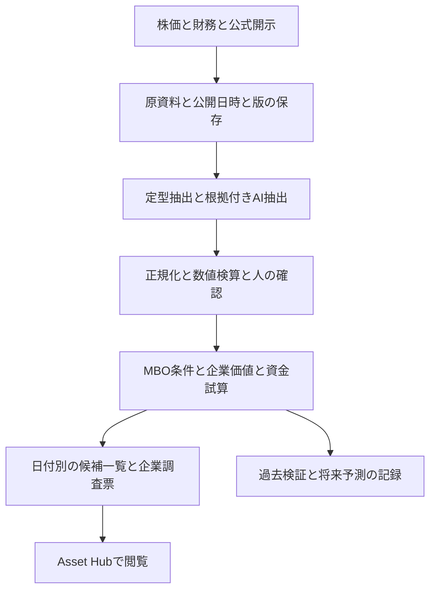

# MBO候補と割安度を調べるシステムの設計

現行案は、同日のユーザー指定を反映した[無料版の設計と実装順](report.md)。以下は有料データも比較した当初案として残している。

設計日：2026-10-18（日本時間）。設計主担当：GPT-6 Astra。公式データ調査とAsset Hub統合：Codex。以下の構成、工程、評価基準は設計案であり、予測精度や投資成績は未測定。

**作れる。最初に作るのは、公開情報からMBOの条件がそろう会社を探し、MBOが起きなくても株価に割安さがあるかを点検する個人用リサーチシステムとする。** 初期版では候補の根拠と障害、企業価値の幅を提示する。MBO発生確率は、基準率と過去検証による校正ができた段階で追加する。

日本の上場普通株を対象とし、12か月以内・24か月以内のMBO初回正式公表を将来の検証対象とする。日次で資料の差分を取り込み、週次で候補を見直す。既存Asset Hubに調査結果を表示し、上位20社程度から毎週5〜10社を人が深掘りする運用を想定する。この件数は処理時間と費用の実測で調整する。

## 1 システムが答える四つの問い

| 問い | 見る内容 | 表示する結果 |
|---|---|---|
| 経営陣がMBOを検討する条件はそろうか | 経営陣・創業家の持分、公開された課題、上場の利点と負担、資本政策、反対し得る株主 | 条件の充足状況、実行障害、反証。初期は確率に換算しない |
| MBOが起きなくても現在の株価は安いか | 平準化した利益・FCF、事業の持続性、余剰資産、負債、同業評価 | 弱気・基準・強気の単独継続価値と現在株価との差 |
| 買い手に資金面の採算はあるか | 必要買収資金、借入返済、出資、金利、出口価値 | 条件別に逆算した支払可能価格帯 |
| 根拠をどこまで確認できているか | 出典、公表日、数値照合、欠測、訂正、名寄せの確かさ | 確認状況と次に必要な資料 |

この四つを独立表示する。例えば、条件がそろっていても株価が単独継続価値より高い会社、割安でも買収資金が成立しない会社を見分けられるようにする。LBOの支払可能価格は、実際の融資約束やTOB価格の予測とは区別する。

MBO・親会社による完全子会社化・第三者による買収・部分TOBを分ける。MBO公表済みと、具体的な検討が公に報じられた企業は「案件監視」に移し、未発見候補と混ぜない。取引分類は公式資料にある経営陣の関与等を確認して決める。[JPXの取引構造に関する説明](https://faq.jpx.co.jp/disclo/tse/web/knowledge8686.html)

## 2 候補を見つける方法

### 全社の一次抽出

過去時点を含む銘柄一覧から普通株を選び、財務・株価・株主情報を付ける。初期は国内の非金融企業の価格評価を優先し、金融機関・REIT等は専用評価式ができるまで自動価格評価を保留する。時価総額や出来高による除外は理由を記録し、探索対象の外に置いた会社も台帳に残す。

一次抽出では、同業・規模に対する評価の低さ、平準化FCF、余剰現金、経営陣との持分関係、株主構成、資料の鮮度を使う。急な株価下落や低PBRは調査の入口として扱い、価値毀損を確認する工程を置く。単なる低PBR順と比較して、深掘りの効率が改善するかを測る。

### 候補の詳細確認

| 観点 | 調査する材料 | 誤判定を避ける扱い |
|---|---|---|
| 意思決定構造 | 経営陣、創業家、資産管理会社、主要株主の議決権と持分異動 | 信託名義から実質所有者を推定しない。家族・資産管理会社の関係は公開資料で裏付ける |
| 経営上の動機 | 公開された承継課題、長期投資、上場維持費、資本政策への説明 | 社長の年齢だけで後継者不在と推測しない。低株価だけでMBO意思があると決めない |
| 資金の成立性 | 数年のCF、投資負担、借入、リース、運転資金、資金規模 | 現金全額を買収原資にしない。借入可能額は条件付き試算にする |
| 公開された行動 | 戦略見直し、資本政策の変更、アドバイザー起用等の正式説明 | 具体的な買収検討の公表・報道が出た時点で案件監視へ移す |
| 障害と反証 | 主要株主の異論、負債負担、業績悪化、投資需要、買収規模 | 候補に有利な材料と同じ欄幅で表示し、仮説を撤回する条件を示す |

MVPでは「条件を確認できた」「重要項目が未確認」「重大な障害あり」を項目ごとに付ける。欠測をゼロ点扱いしたり、低い発生確率と読み替えたりしない。定量的な抽出順位と、詳細確認の進捗を別の列にする。スコア配点は当初の仮説として版管理し、成績を見ながら無制限に調整しない。

会社ごとに、肯定する根拠を最大3件、否定材料を最大3件、見方を変える条件、次に読む資料を表示する。資料がない欄は埋めず、確認が必要な項目として残す。

## 3 割安さと買収価格を評価する方法

### 単独継続価値

事業を続ける場合の価値を、FCFを割り引くDCF、同業倍率、調整純資産で照合する。DCFを作れない業種・資料不足の会社は計算を保留できる設計にする。会社予想、実績からの平準化、独自の成長・金利シナリオを分け、PER・PBR・EV/EBITDAは割安と判断した根拠を点検する補助指標にする。

主な調整は、一過性の売却益、景気の山の利益、維持投資と成長投資、運転資金、制約のある現金、余剰不動産や政策保有株の税引後価値、リース、非支配持分、希薄化である。事業CFに含めた資産収益と、資産売却価値の二重計上を防ぐ。株価・EPS・株数は通貨と分割基準をそろえる。

基準価値に対する割安率と、弱気価値まで下がる幅を同時に出す。基準価値より安くても、弱気ケースの損失が大きければ、MBO期待だけで優先順位を上げない。

### 買収資金の成立価格

借入を使う買収の採算モデルを別に作る。買収代金、既存借入の借換え、手数料、必要現金を資金使途に入れ、借入、出資、利用可能な現金等の調達と一致させる。経営陣が持分を継続すると必要現金は変わるが、会社全体の株式価値がその分増えるわけではない。

金利、返済条件、業績悪化、設備投資、出口の評価倍率、スポンサーの要求収益率を変えて、採算が成立する買収価格を逆算する。融資の可否は銀行に確認できないため、借入額を確定値として出さない。**単独継続価値、買い手が払える価格、一般株主への実際の買付価格はそれぞれ別**に表示する。

### 高い買収プレミアムだけでは採算は分からない

以下は実在銘柄の予測ではなく、説明用の独自シナリオ。現在1,000円、2年後にMBOなら1,800円、起きなければ900円となり、両方とも2年後に結果が確定、配当・税・費用はゼロとする。

発生確率を仮に5%と置くと、2年後の期待価値は `0.05 × 1,800 + 0.95 × 900 = 945円`。MBO価格が現値より80%高くても、期待価値は現値を下回る。

2年後の期待価値が、現値を年8%で複利成長させた1,166.4円に達する境界は、`p = (1,166.4 − 900) / (1,800 − 900) = 約29.6%`。これは仮定上の必要確率であり、推定した実際のMBO確率でも、年8%を達成する確率でもない。この計算を「現在の株価にはどの程度のMBO期待が必要か」という感応度表示に使う。

## 4 データと月額費用

2026-10-18に確認した公式情報では、Standardに株価・財務サマリー・大株主等のデータがある。詳細なBS/PL/CFはPremiumなので、Standardを使う案ではEDINETのXBRL・有報と会社資料から補完する。APIの存在だけで、各社の必要項目や履歴がそろうと判断しない。[データの対象範囲](https://jpx-jquants.com/ja/spec/data-spec)

| 構成 | データ月額 税込 | 適した段階 | 制約 |
|---|---:|---|---|
| 費用を抑える案 | 3,300円 | J-Quants StandardとEDINET・会社IRで調査票と一次抽出を試す | 会社IR収集の手間と取り漏れがあり、適時開示全体の監視には不足し得る |
| 日次監視を整える案 | 14,300円 | Standard 3,300円にTDnetアドオン11,000円を追加 | 適時開示の取得範囲を改善できるが、訂正・取消の照合やIR補完は必要 |

Standardの価格は[JPXの現行比較表](https://www.jpx.co.jp/markets/paid-info-equities/historical/)、TDnetアドオンの価格・過去5年の履歴・Light以上という条件は[2026年5月18日発表](https://www.jpx.co.jp/corporate/news/news-releases/6020/20260518-01.html)による。Freeは12週遅延のため、足元の候補監視には採用しない。[プラン別提供期間](https://jpx-jquants.com/ja/spec/data-spec)

LLM費は最初に**月3,000円の支出上限を設定する案**とする。料金の実測予測ではなく、上限に達したら処理を止めて未処理資料を表示するための予算案である。データ代と合わせた月額上限案は6,300円または17,300円に、別途インフラ費・初回履歴取得処理費が加わる。ローカル試行なら追加のクラウド稼働を省ける。LLMのモデル、単価、データ処理条件を決め、サンプルを処理してから件数を確定する。

大株主等の履歴には収録開始日があり、プランの「10年」という表示と実際の取得年数は一致しない場合がある。個人向けAPIの法人利用・二次配布は対象外のため、本人用の非公開利用を前提とする。外部共有を始める場合はデータ経路と利用条件を再設計する。[株主データ等の制約と出典一覧](related-links.md)

## 5 Asset Hubへの組み込み

PythonバッチとローカルSQLiteで収集・計算し、確認した結果を日付別JSONに書き出す。既存のHTML/CSS/JSで候補一覧と企業詳細を表示する。日付別の調査は現在のカタログから開ける構成にし、画面の表示のためだけに常時動くAIや新しいDBサーバーを導入しない。

初期の画面は次の三つに絞る。

- **候補一覧**：株価時点、抽出順位、MBO条件、単独継続価値の幅、弱気時の下落幅、資金試算、情報の古さ。MBO条件と割安率で比較できる。
- **企業調査票**：根拠と反証、株主構成、価値計算の前提、条件別の価格、一次資料へのリンク、確認が必要な項目。
- **案件監視と検証**：公表・検討報道後の案件、過去の候補、候補にした時点、事後の経過、処理失敗や費用。

日次取得、資料更新時の再計算、週次の人手確認、月次の候補凍結を分ける。失敗時は前回の成功版を表示し、更新日と未取得件数を明示する。自動通知は、定期実行を採用する段階で候補入り・重要開示・仮説を崩す変化の基準を決める。

現行Asset Hubは読み取り専用サーバーであり、クラウドのローカルディスクを永続保存に使わない。将来Cloud Run Job等にバッチを移す場合は、原資料と成果物を非公開の永続ストレージへ保存し、画面には確認済みの出力だけを渡す。[データ項目と運用仕様](technical-design.md)

## 6 本当に役立つかを確かめる方法

**候補を発見する能力と、投資した場合の成績を別に評価する。** 正式MBO公表、成立、撤回、競合TOBを別ラベルにし、公表後に撤回された会社も「正式公表を予測する」評価では陽性のままとする。

当時上場していた母集団を復元し、上場廃止企業も含める。各数値に対象期間と公開日時を持たせ、後日開示された有報や訂正値を過去の評価へ混ぜない。現在取得した資料から当時の版を確認できる「事後再構成」と、当時実際に取得して処理できた「実運用再現」は成績を分ける。

LLMは過去案件の結末を知っている可能性がある。過去検証で使うLLMの役割を、固定した定義に沿った引用確認済みの事実抽出に限定する。定性的な「MBOしそう」というLLMの見立ては今から日時付きで保存し、前向きに検証する。INFORICHは着想源なので配点調整にも成績評価にも使わない。

| 検証項目 | 方法 |
|---|---|
| 市場の発生率 | 企業年あたりの発表件数と、基準日から12/24か月の条件付き発生率を実測。選んだ成功例の割合から推定しない |
| 候補探索の効率 | 上位10/20社の的中割合、基準モデルに対する改善率、同じ案件を重複計上しない捕捉率、第一報までの先行日数 |
| 調査の効率 | 1社あたりの確認時間、原本に戻れる割合、数値修正率、未処理資料と欠測率 |
| 投資した場合 | 翌営業日以降の約定可能性、配当、費用、スプレッド、出来高、資金拘束を含めた成績。全体とMBO発生・非発生・不成立の内訳を併記 |
| 比較対象 | 単純な低PBR、低PBRとオーナー条件の組合せ、規模・業種・割安度が近い対照群、TOPIX等 |
| 確率モデルの採用 | 予測と実現率の一致、Brier score、校正曲線、不確実性を確認。標本が不足する場合は確率表示を保留 |

過去から未来へ進む検証を使い、学習時点で将来12/24か月の結果が判明している観測だけを学習に使う。同じ会社の月次データを無作為に分けず、期間の重なりを除き、企業単位の分離も追加確認する。具体的な検討報道後の値は未発見候補の検証から外す。報道履歴を復元できない場合は、正式公表30日・90日前まで情報を止める感応度検証も出し、独自発見の実績と呼ばない。

たとえば2026-10-18を観測終了日とすると、2025-10-18より後の基準日に対する12か月ラベルは未成熟である。24か月では2024-10-18より後が該当する。途中までMBOがない会社を陰性確定にしない。競合する買収や上場廃止、観測終了の扱いを固定して検証する。

TDnetアドオンの履歴は過去5年で、株主データにも固有の収録開始日がある。12/24か月ラベルの成熟を待ち、学習と評価の期間を分けると、有効な検証期間と案件数はさらに小さくなる。Standardの「10年」を全部の資料がそろう10年検証と解釈しない。初期の履歴だけでは確率校正に必要な標本に届かない可能性を前提にする。[データの収録範囲](https://jpx-jquants.com/ja/spec/data-spec)

未使用の過去期間でも、設計者が既知のMBOを知っていれば完全な盲検にはならない。過去検証の後もルールを固定した前向き記録を続ける。12/24か月の予測を数週間の稼働だけで検証済みとはしない。

## 7 実装の順序と完成条件

以下はastraの工程案を統合した仮置き。1名相当の実装と必要な人手レビューを想定し、初期データ整理の結果で見直す。

| 段階 | 目安 | 完成物と判断 |
|---|---|---|
| データと評価票の試験 | 第1週 | 20〜30社で原本・時点・株主・価値計算を確認。価格と利用条件、欠測、作業時間を測る |
| 手動基準版と取得の土台 | 第2〜3週 | 原本台帳、訂正履歴、評価票、財務計算、固定ルールによる一次抽出を作る |
| 操作できるMVP | 第4〜6週まで | 対応できた母集団の走査、上位候補の根拠、企業詳細、日付別保存、Asset Hubでの閲覧 |
| 履歴検証と運用準備 | 全体で第6〜10週まで | 当時の母集団と案件台帳、時点検証、基準モデル比較、費用制限と障害復旧を確認 |
| 精度の継続確認 | 以後12/24か月以上 | 固定したルールの予測と経過を保存し、満期を迎えた期間から検証する |

第1週のサンプルは、過去MBO10社、観測期間を満たす非MBO10社、撤回・競合等5社程度を仮置きする。撤回等はMBO群と重複してよい。これは選別した実現性試験であり、市場の発生率やモデル精度を推定できる標本ではない。現在の候補リストと検証用サンプルを混同しない。

MVPの完成条件は、候補の主要根拠を原本へたどれること、主要な金額・株数・日付を検算できること、欠測を埋めずに表示できること、同じ入力から同じ計算値を再現できること、本人が一覧から調査先を選べることである。

次の段階へ進める基準も先に置く。主要データの原本復元が難しければ確率モデルの開発を保留して証拠整理に集中する。候補の精度・確認時間が単純基準を改善しなければ学習モデルへの拡張を保留する。費用と作業時間が許容範囲を超える場合は対象社数・更新頻度を減らす。数値による受入条件は[技術設計](technical-design.md)で仮置きし、最終評価前に固定する。

**着手時のデータ経路は、StandardとEDINET・会社IRの案に加え、バフェット・コードのデータソリューションも比較する。** 同日の追加確認では、後者にも詳細財務、大株主、会社資料の検索・取得APIがあることが分かった。必要項目と利用条件を満たす場合はこれを主要経路にし、株価履歴や当時版の再現など不足する部分を補完する。[バフェット・コードの適合性と確認事項](buffett-code-assessment.md)

評価票の試験を先行させ、データ費・原本確認の時間・履歴の再現性を測って経路を選ぶ。TDnetを含む重複契約を最初から必須にしない。

同日の料金ページ確認により、最初の試作にはバフェット・コードのライト（月990円表示）を使う案も追加した。月1回、人が候補CSVを取得し、上位5〜10社を原本で深掘りする構成なら、全社の日次API取得より先に調査方法を検証できる。業績CSVは5年・月20件、四半期CSVや実質株主氏名等は対象外のため、必要箇所を公開資料で補う。[ライトの提供範囲と試作案](buffett-code-assessment.md#5-ライトプランで始める場合)
